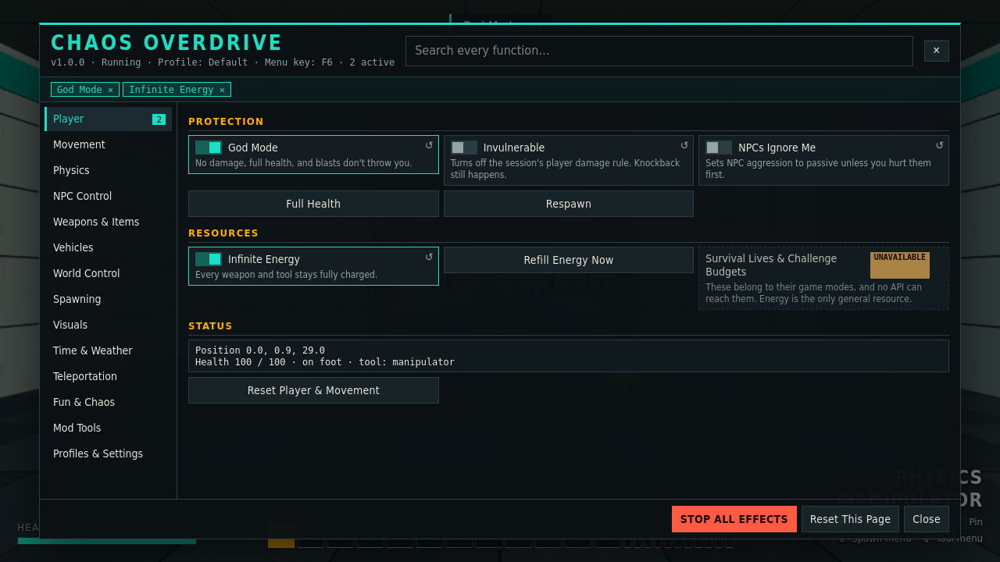
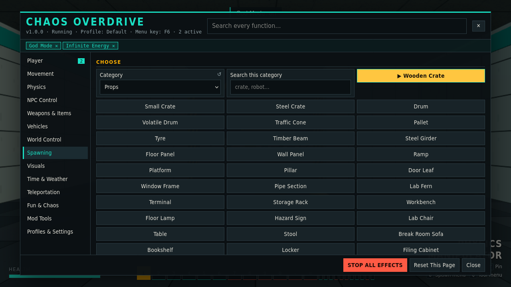
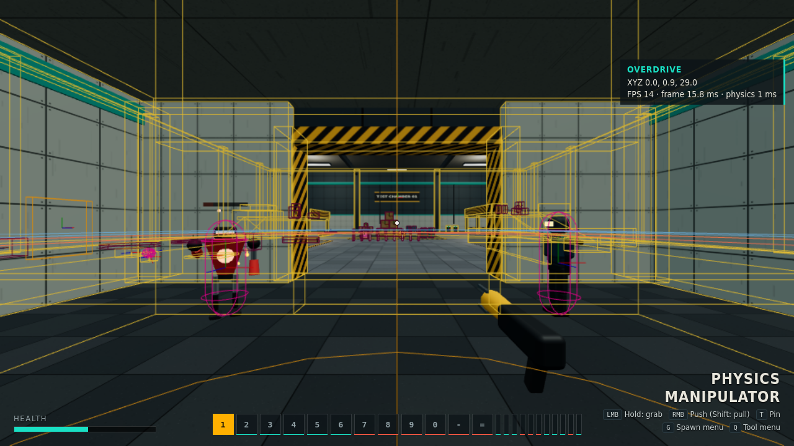
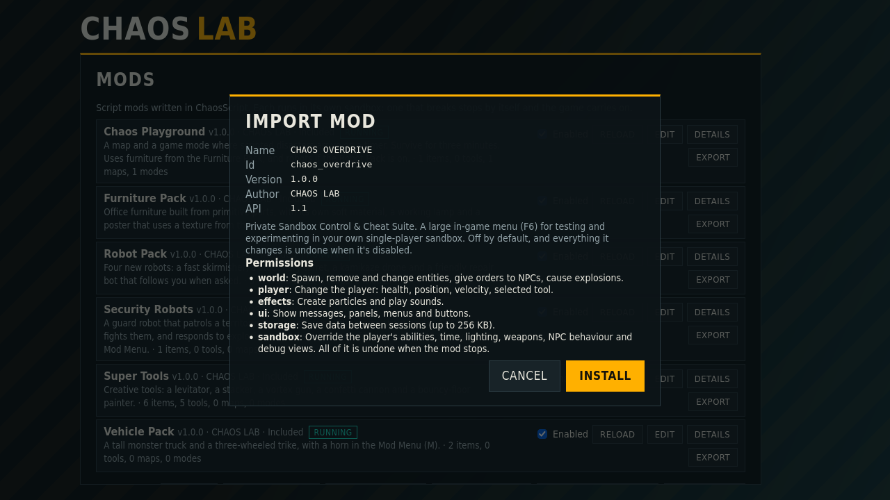

# CHAOS OVERDRIVE

**A sandbox control and cheat menu for your own single-player [CHAOS LAB](https://github.com/anoplaymc/CHAOS-LAB) game.** Test things, run experiments, and take full control of the world from one searchable menu. It's off until you turn it on, and turning it off puts everything back.



## Features

- **169 functions in 14 categories**, with search, sliders, toggles and lists.
- **Player:** God Mode, invulnerability, infinite energy.
- **Movement:** speed, jump height, gravity, free flight and No Clip.
- **Physics:** gravity, pausing all objects, and changing the mass, material, size and motion of any object.
- **NPCs:** create, freeze, heal, change sides, set speed and detection range, and give orders, one at a time or all at once.
- **Weapons and vehicles:** equip anything, tune damage and fire rate, and tune each vehicle by itself.
- **World:** time of day, sky, fog, light, and a spawner with limits and a cancel button.
- **Visuals:** physics colliders, NPC detection ranges and movement, coordinates and FPS, each on its own switch.
- **Profiles:** several sets of settings, with import and export, and keys you can change.
- **Clean exit:** the game itself undoes every change when the mod is disabled, and nothing is sent anywhere.

| Spawning | Debug views |
| --- | --- |
|  |  |

## Requirements

- **CHAOS LAB with Mod API 1.1 or a later 1.x**, which is any version whose Mods screen has an **Import Mod** button. An older game refuses the mod with *This mod needs API version 1.1*.
- A browser that can run CHAOS LAB. Import Mod also needs ZIP support built into the browser, which current Firefox, Chrome, Edge and Safari have.

| CHAOS OVERDRIVE | Mod API |
| --- | --- |
| 1.0.0 | 1.1 |

## Installation

Download `chaos_overdrive-1.0.0.zip` from the [Releases page](https://github.com/anoplaymc/CHAOS-OVERDRIVE/releases). GitHub's **Code > Download ZIP** of this repository works too.

### Method 1: Import Mod

This is the way to install it if you play a built or hosted copy of the game. It needs no files on disk beyond the ZIP.

1. In the main menu, click **Mods**. It's also in the pause menu.
2. Click **Import Mod**, in the row of buttons at the bottom of the Mods screen.
3. Choose the ZIP. The game only takes a file from your computer, and can't download from a GitHub link, so download the ZIP first.
4. Wait for the check, which takes moments. A window then shows the name, version, author, permissions and dependencies, and nothing has been installed yet. **Cancel** stops here.
5. Click **Install**, wait for the message that it's installed, and click **Close**.
6. In the mod's row, tick **Enabled**. It arrives turned off.
7. Start or resume a game, and press **F6**.



If the window asks you to tick a box to **Replace** a mod, a copy is already there. See [Updating](#updating).

### Method 2: By hand, in a copy of the game's source

This is for a copy of the game cloned from GitHub. A built or hosted copy has no `mods` folder to add to, because its mods are bundled when it's built, so use Method 1 there.

1. Download the ZIP and unpack it.
2. Find the `mods` folder at the top of your CHAOS-LAB folder.
3. Put the `chaos_overdrive` folder in it. Check that this path exists:

   ```text
   CHAOS-LAB/mods/chaos_overdrive/mod.json
   ```

   - Unpacking the release ZIP gives you `chaos_overdrive` directly.
   - Unpacking GitHub's ZIP gives you `CHAOS-OVERDRIVE-main/chaos_overdrive`. Move only the inner folder, and not `CHAOS-OVERDRIVE-main`.
4. Run `npm run dev`, or if it's already running, reload the page. For a production build, run `npm run build` again.
5. In **Mods**, tick **Enabled** in the CHAOS OVERDRIVE row.
6. Start a game, and press **F6**.

## Using it

| Key | Action |
| --- | --- |
| **F6** | Open or close the menu. Esc closes it too |
| **F7** | Select what's under the crosshair |
| **F8** | Stop all effects |

The menu also opens from the Mod Menu (**M**). Keys can be changed under *Profiles & Settings*. Your settings apply again at the start of each new session.

To try a ready-made configuration, copy [examples/profile.example.json](examples/profile.example.json) into the import box under *Profiles & Settings*, then press **Import**. It replaces the settings of the current profile.

## Updating

- **Installed with Import Mod:** import the new ZIP. Tick the box to replace the old version, then click **Replace**. Your settings are kept.
- **Installed by hand:** replace the `chaos_overdrive` folder with the new one, and reload or rebuild.

Check [CHANGELOG.md](CHANGELOG.md) for what changed.

## Removing

- **Installed with Import Mod:** in **Mods**, click **Remove** in the mod's row, then **Really remove**. This also deletes its settings, profiles and saved points.
- **Installed by hand:** delete `mods/chaos_overdrive`, and reload or rebuild. Its settings stay in the browser in case you reinstall it.
- **Just turning it off:** untick **Enabled**. Every change is undone, and everything it created is removed.

## Troubleshooting

| Problem | What to do |
| --- | --- |
| No **Import Mod** button | The game is too old. Update CHAOS LAB. |
| *This mod needs API version 1.1* | The game is too old. Update CHAOS LAB. |
| *This archive has no mod.json* | That isn't this mod's ZIP. Download it again from Releases. |
| *This is not a ZIP archive, or it is damaged* | The download is incomplete. Download it again, and compare it with the release's `.sha256` file. |
| *mod.json is too deep* | The ZIP was re-packed with extra folders. Use the original download. |
| It doesn't appear after installing by hand | Check for `mods/chaos_overdrive/mod.json`, with no extra folder between. Then reload, or rebuild a production build. |
| F6 does nothing | Check that the mod says **Running** in Mods, and that you're in a game and not paused. The menu doesn't open from the main menu. |
| F6 does something in the browser instead | Choose another key under *Profiles & Settings*. |
| The new key is refused | Keys the game uses, and F5, F11 and F12, can't be taken. |
| The game is slow | Turn off *Physics Colliders*, and use *Remove Everything This Mod Created* under Spawning. |
| Something behaves oddly and you don't know why | Press **F8**, or **STOP ALL EFFECTS** in the menu. |
| Settings disappeared | They live in the browser's site data, so clearing it or using a private window loses them. Export them under *Profiles & Settings* to keep a copy. |

## Functions

The full list, with what each one does, is in [docs/FEATURES.md](docs/FEATURES.md).

| Category | Functions |
| --- | --- |
| Player | 8 |
| Movement | 9 |
| Physics | 21 |
| NPC Control | 19 |
| Weapons & Items | 12 |
| Vehicles | 13 |
| World Control | 15 |
| Spawning | 13 |
| Visuals | 10 |
| Time & Weather | 6 |
| Teleportation | 10 |
| Fun & Chaos | 18 |
| Mod Tools | 5 |
| Profiles & Settings | 10 |

A function here is one row in the menu, so each slider counts as one.

## Known limitations

- **Not available**, and marked so in the menu:
  - Rain, snow and wind, because the game has no such system. Weather here means sky, light and fog.
  - Survival lives and challenge budgets, which the mod API can't reach.
  - Inventory and ammunition pickups, which the game doesn't have. Weapons are hotbar slots with energy bars.
  - System commands and arbitrary files. Mods run in a sandbox, by design.
- Effects end with each session, and your profile applies them again in the next one.
- Turning the mod off or reloading it removes what it created.
- Weapon tuning applies to all weapons together.
- Time Scale changes your own speed too. Pausing physics doesn't stop debris or shots already fired.
- Saved games keep the session's real gravity, damage and aggression, not the menu's. A size or material you gave an object is saved as it was.
- Spawning is limited to 100 per request, asks first above 10, and stops if the frame rate falls below 8. The game's own limits on objects still apply.
- The menu is in English only.

This is for your own single-player game. It has no multiplayer features, and makes no network connections.

## How it works

Everything is ChaosScript, in [chaos_overdrive/](chaos_overdrive/), running in the game's mod sandbox. There's no JavaScript in this repository, and nothing runs during an import. See [chaos_overdrive/README.md](chaos_overdrive/README.md) for more.

## License

No license has been chosen yet, so all rights are reserved by default. A `LICENSE` file will be added here when one is.

## Related

- **The game:** [CHAOS LAB](https://github.com/anoplaymc/CHAOS-LAB)
